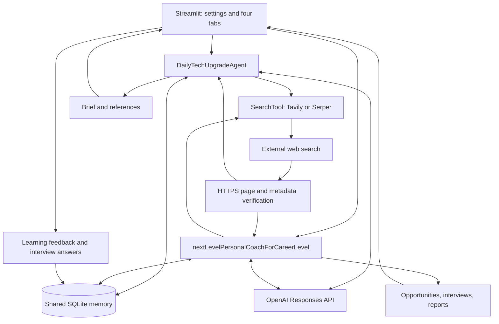
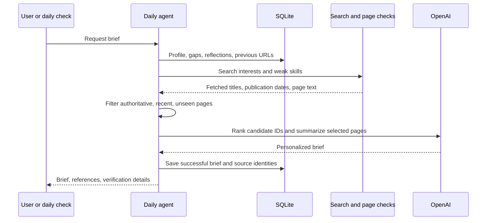
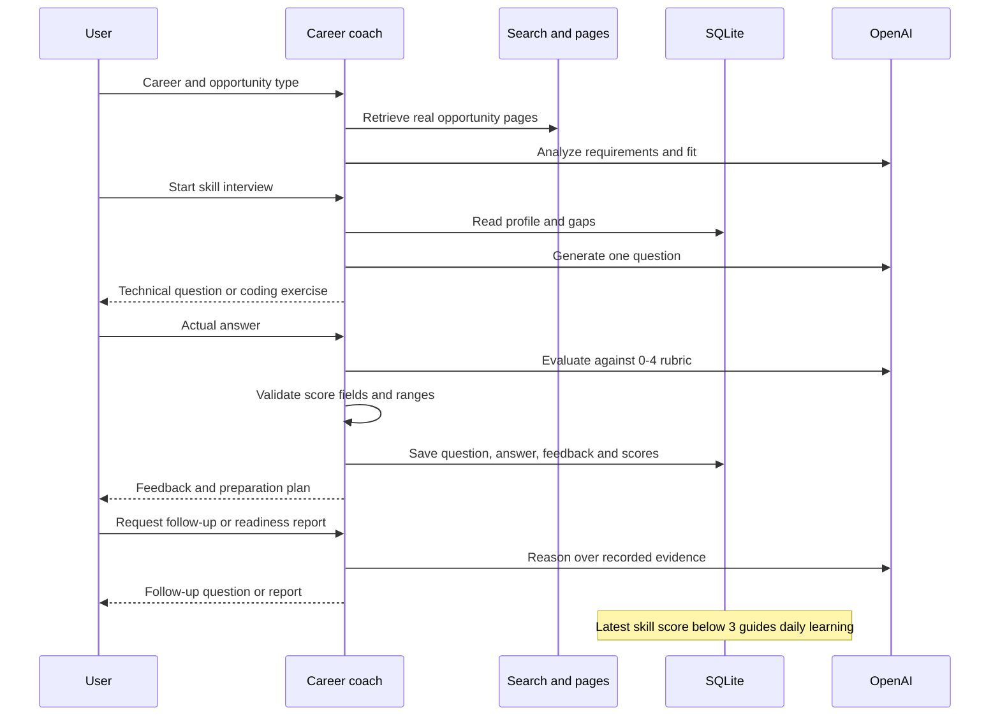

# Personal AI Coworkers

Two personalized agents in a local, single-user Streamlit application for an SJSU Agentic AI assignment. Python 3.11+.

## Installation and execution

From this repository in PowerShell, with Python installed:

```powershell
py -3 -m venv .venv
.\.venv\Scripts\python.exe -m pip install -r requirements.txt
Copy-Item .env.example .env
# Edit .env and supply your own keys.
.\.venv\Scripts\python.exe -m streamlit run app.py
```

On macOS/Linux:

```bash
python3 -m venv .venv
.venv/bin/python -m pip install -r requirements.txt
cp .env.example .env
.venv/bin/python -m streamlit run app.py
```

Open the localhost URL shown by Streamlit. Profile, history and dashboard work without keys. AI features require `OPENAI_API_KEY` and a model your account can access (`OPENAI_MODEL`, default `gpt-4.1-mini`). Search requires `SEARCH_PROVIDER=tavily` with `TAVILY_API_KEY`, or `SEARCH_PROVIDER=serper` with `SERPER_API_KEY`. Restart after editing `.env`. External calls may incur charges. There is no simulated-results mode in the UI.

## Agent goals and outcomes

**DailyTechUpgradeAgent:** retrieve and verify recent authoritative technical articles, rank up to three against interests, goals and interview gaps, and produce an 18-minute reading/practice/reflection brief. Expected outcome: traceable daily learning with less repetition.

**nextLevelPersonalCoachForCareerLevel:** retrieve internship, job or research pages, analyze technical requirements, conduct multi-turn technical/coding practice, assess actual answers and produce a Career Readiness Report. Expected outcome: evidence-based practice feedback and actionable preparation.

## How to use

1. Save your interests, target career, experience and goals in Settings / Profile.
2. Generate a Daily Learning brief. Inspect sources and verification details. Record usefulness, completion and learning reflections.
3. Search opportunities in Career Coach. Confirm eligibility and vacancy status on the employer page.
4. Start a technical interview or coding exercise, optionally with a job description. Answer, inspect feedback, and request a follow-up. The current interview resumes after restart.
5. Generate/download a readiness report after an assessed answer. Review Learning History and Progress Dashboard.

## Architecture







## Shared memory

SQLite defaults to `data/coworkers.db`; override with `DATABASE_PATH`. `settings` stores profile, career goals, scheduling options and resumable interview state. `events` stores briefs and article identities, learning reflections, opportunities, interview sessions/answers, evaluations, skills, scores and readiness reports. `daily_runs` prevents duplicate automatic attempts for a calendar date.

The latest assessed score below 3/4 marks a skill as weak. Daily learning includes those skills in search and ranking. Recent learning reflections also influence ranking and briefs. This transparent rule is not a calibrated competence estimate. Memory persists across restarts; remove the local database only if you want to reset your data.

The Progress Dashboard also reads saved qualitative `evaluation.gaps` and individual rubric scores below 3/4, even when the overall score is at least 3. It shows evidence from the latest assessment for each career/skill pair; older feedback remains in history and can inform readiness reports. Historical records without qualitative gaps still contribute recorded low scores. No gaps are inferred from report prose or missing fields.

## Reliability, security and limitations

- Article discovery makes up to three topic/publisher searches, stopping once three eligible new articles are available. Tavily requests an explicit rolling 30-day window using `start_date` and `end_date` without `time_range`, restricted publisher domains and publication dates. Fallback expands to IBM, IEEE, ACM and additional Google research sources. Each search may incur provider charges. Books, events, documentation, index pages and utility pages are excluded before recommendation.
- Article titles come from fetched pages. Publication dates are extracted from Article JSON-LD, publication/Open Graph metadata, labeled HTML time elements and explicitly labeled publication text. Provider dates are candidates cross-checked with page evidence; provider-only dates cannot establish original publication. Update dates are shown separately and never reset freshness. Conflicting page dates are rejected. Only authoritative pages originally published within the strict 30-day window and not previously recommended are eligible. Missing dates, PDFs and blocked pages are excluded. There may be fewer than three articles or none. Verification details show search attempts, evidence, provider-date comparisons and rejection reasons.
- Page metadata can be inaccurate. Metadata verification does not independently establish every source claim. Review AI summaries. A fetched opportunity page does not prove a vacancy is open; general careers pages and aggregators may appear.
- Interview scores use correctness, reasoning and application (0-4 each), with the arithmetic mean displayed. They are AI practice assessments, not hiring predictions. Submitted code is reviewed by inspection and never executed.
- Daily scheduling uses a 60-second Streamlit fragment while a browser session is active. It attempts once after the configured server-local hour, including catch-up when opened later that day. It cannot run when the app/session is closed or the machine sleeps. A failed/empty automatic attempt needs a manual retry. Manual runs are separate and can incur additional charges. An unattended OS-scheduler CLI is not implemented.
- URL checks reject private IPs, credentials, non-HTTPS destinations and nonstandard ports, including redirects; fetch time/size are capped. This local prototype still needs stronger DNS-rebinding and prompt-injection defenses before public deployment.
- Keys live in `.env`, never SQLite. Git ignores keys, runtime files, local data and SQLite sidecars. SQLite is unencrypted. There is no authentication or multi-user isolation; keep the app local. Profile, search queries, page text and answers are sent to the configured providers as needed. Avoid sensitive data.
- Model rankings and rubric fields are validated. Generated prose can still contain errors. Long interview sessions can reach model context limits; start a new session. Reports use the latest 50 answers and resources from the latest five briefs. Dependencies use ranges rather than a lockfile.
- Article ranking uses explicit candidate indices and a strict Responses JSON schema; a custom `OPENAI_MODEL` must support structured outputs. One or two candidates are handled without requesting nonexistent articles. If ranking output is malformed, a labeled local fallback orders only eligible candidates by topic overlap (weak-skill matches weighted twice), then original publication date and discovery order. API failures remain errors. Ranking diagnostics omit profile/content, provider IDs and raw responses.
- No live API success, interview quality or scheduler success is claimed without actual evidence. See [testing status](docs/TESTING.md).

## Checks and assignment deliverables

```powershell
.\.venv\Scripts\python.exe -m unittest discover -v
.\.venv\Scripts\python.exe -m compileall -q app.py coworkers tests
```

Offline tests use temporary databases and explicitly synthetic model/search fixtures, with no paid calls. [Evaluation methodology](docs/EVALUATION.md) defines accuracy, effectiveness and progress measures and a procedure for collecting real assignment examples. Real API results still need configuration and collection; none are invented.

On this development machine, an ignored portable Python runtime was downloaded for validation because Python was absent from PATH. You can also run it directly from the repository:

```powershell
Copy-Item .env.example .env
# Fill in .env before using AI features.
.\.runtime\python\python.exe -m streamlit run app.py
```

The portable runtime is not committed; other machines should use the standard installation steps above.

## Files

```text
app.py                   Streamlit UI and daily fragment
coworkers/agents.py      Both agent workflows and rubric validation
coworkers/search.py      Search adapters, URL checks and page metadata
coworkers/article_dates.py Publication evidence and excluded page types
coworkers/ranking.py     Ranking schema, validation and deterministic fallback
coworkers/llm.py         OpenAI integration and error handling
coworkers/memory.py      Persistent SQLite settings and event history
tests/test_workflows.py  Offline workflow tests
docs/EVALUATION.md       Evaluation protocol and real-result template
docs/TESTING.md          Actual testing status
.env.example             Configuration without secrets
requirements.txt         Runtime dependencies
```

No changes are pushed to GitHub automatically.
